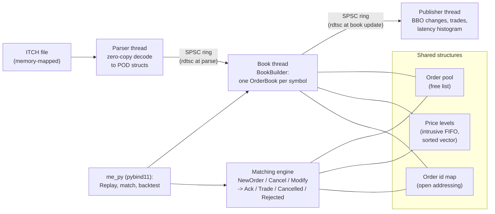

# Tachyon

Tachyon is a C++20 trading core with two separate halves. The first is a NASDAQ
TotalView-ITCH 5.0 feed handler: it decodes a full day of the exchange's binary
feed (368 million messages, 11.2 GB) and rebuilds every symbol's limit order book,
message by message. Replaying ITCH **rebuilds** a book; nothing is matched, because
every execution in the feed already happened at the exchange and the book only
removes the shares the feed reports. The second half is a **matching engine** that
does match: it accepts new orders, cancels and modifies and decides the trades
itself with price-time priority. The two share the same order, level and id-map
structures, are connected to a threaded pipeline by lock-free rings, and are exposed
to Python. The hard parts are getting a full day exactly right (one wrong byte swap
or one mishandled replace silently corrupts every book after it), keeping the hot
path free of locks and heap allocation, and measuring latency honestly on hardware
that was not set up for it.

## Results

All numbers are medians of at least five runs, with the range in brackets, from the
files in [`results/`](results/). The machine is an AMD Ryzen 9 8940HX laptop (16
cores, 16 GB, Windows 11, MSVC 19.44 release build, Balanced power plan, turbo not
disabled). See [docs/benchmarks.md](docs/benchmarks.md) for the method and what each
number means.

| What | Result | Source |
|---|---|---|
| Full day replayed, unknown order references | 368,366,634 messages, **0** | [m3/full_day_replay.json](results/m3/full_day_replay.json) |
| Threaded vs single-threaded books, full day | identical at all 14 checkpoints and in all 174,890,436 BBO changes | [m4/full_day_pipeline.json](results/m4/full_day_pipeline.json) |
| Parse only, full day / in page cache | 15.8M / 30.5M msgs/s | [m6/parse_throughput.json](results/m6/parse_throughput.json), [m6/parse_prefix_throughput.json](results/m6/parse_prefix_throughput.json) |
| Parse + book build, full day | 3.07M msgs/s [2.79M..3.13M] | [m6/book_throughput.json](results/m6/book_throughput.json) |
| Book update latency, add / delete | p50 191 / 231 ns, p99 575 / 631 ns | [m6/book_op_latency.json](results/m6/book_op_latency.json) |
| Pipeline latency at 1M msgs/s | p50 411 ns, p99 15.6 us, p99.9 103 ms | [m6/pipeline_latency.json](results/m6/pipeline_latency.json) |
| Matching engine | 4.94M orders/s [4.91M..5.01M], p50 70 ns, p99 323 ns | [m6/matching_engine.json](results/m6/matching_engine.json) |
| Id map lookup, custom vs `std::unordered_map` | 8.3 vs 55.9 ns (6.7x); churn 244 vs 963 ns (3.9x) | [m6/micro.json](results/m6/micro.json) |

Two results miss the targets set at the start. Book updates take about 190 to 230 ns
at the median, not under 100 ns; the working set of a full day (1.7 million live
orders) does not fit in cache. The pipeline's p99.9 is above 100 ms, because the
book thread occasionally stalls on this machine (no isolated cores, power
management on) and every queued message inherits the stall. Both are explained in
[docs/benchmarks.md](docs/benchmarks.md). Hardware counters (`perf stat`) were not
available on Windows, so the cache explanations are inferences.

## Architecture



- [docs/parser.md](docs/parser.md): ITCH framing, zero-copy decoding, fuzzing.
- [docs/book.md](docs/book.md): pool, levels, id map, message semantics, the full-day replay and its crossed books.
- [docs/pipeline.md](docs/pipeline.md): the SPSC ring and its memory ordering, timestamps, the threaded run.
- [docs/matching.md](docs/matching.md): matching rules, including modify priority.
- [docs/python.md](docs/python.md): the bindings and the backtest.

## Build and run

Requirements: CMake 3.25+, Ninja, Python 3.11+, and either Visual Studio 2022 Build
Tools (Windows) or GCC 12+ / Clang 15+ (Linux). GoogleTest, Google Benchmark and
pybind11 are fetched by CMake.

```sh
git clone https://github.com/ArnavLifelessCoder/tachyon.git && cd tachyon
python -m venv .venv && . .venv/bin/activate      # Windows: .venv\Scripts\activate
python -m pip install -r requirements-dev.txt
cmake --preset debug -DPython3_EXECUTABLE="$(which python)"
cmake --build --preset debug
ctest --preset debug                               # all C++ and Python tests
```

On Windows, run these from a Visual Studio x64 developer shell, or use
`./scripts/test.ps1 -Preset debug` (it also applies the Windows sanitizer policy in
[docs/build.md](docs/build.md)). Other presets: `asan` (ASan + UBSan on Linux),
`tsan` (Linux only), `release` (benchmarks).

Replay a full day and run the benchmarks (needs about 16 GB of free disk):

```sh
python scripts/download_itch.py 2019-01-30
cmake --preset release -DME_BUILD_BENCHMARKS=ON && cmake --build --preset release
python scripts/replay_day.py --replay build/release/book_replay --output results/m3/full_day_replay.json
python scripts/pipeline_day.py --pipeline build/release/pipeline_replay --output results/m4/full_day_pipeline.json
python bench/run_benchmarks.py --build build/release --output results/m6
python python/latency_plots.py --results results/m6
```

Use the bindings and the backtest:

```sh
python python/backtest.py tests/fixtures/01302019.AAPL-MSFT-SPY.itch \
    --symbol AAPL --module-dir build/release --output results/m7
```

## Design decisions

- **Sorted vector of levels over a tree.** Almost all ITCH activity is within a few
  ticks of the touch, so each side keeps a vector sorted worst to best and searches
  from the best end. Level churn near the touch measured about 2.1x faster than
  `std::map` (43.0 vs 92.1 ns). The cost is O(distance) for a level far from the
  touch, which is rare.
- **Open addressing with backward-shift deletion over `std::unordered_map`.** A full
  day deletes as many orders as it adds; tombstones would slowly lengthen every
  probe, and node-based maps chase a pointer per lookup. The custom map is 6.7x
  faster on lookups that hit and 3.9x under steady-state churn.
- **Pooled orders with an intrusive FIFO over separately allocated orders.** Orders
  come from 64K-element chunks with a free list, so the hot path never allocates
  once warm. Tests replay the fixture twice and require zero heap allocations on the
  second pass, for the book and for the matching engine.
- **A differential test against a slow reference over clever unit tests alone.**
  The book is compared against a `std::map`/`std::list` book on 10,000 random
  streams, the parser against a pure-Python decoder, and the matcher against a
  Python matcher that re-sorts a flat list every time. Each reference shares no code
  with what it checks, so a shared misunderstanding has to be made twice to slip
  through.
- **A modify that only shrinks keeps priority; anything else loses it.** Reducing
  quantity asks for nothing new, while a price change or size increase is treated
  as cancel plus re-add and can trade immediately on re-entry.
- **Cache-line padding in the ring, kept even though it only helps across CCDs.**
  On the same CCD the padded and unpadded rings measured the same; with the
  consumer on the other CCD the padded ring was about 1.6x faster at the median.
  The padding costs nothing, so it stays.

## Testing approach

- **Differential tests** are the main tool: book vs `std::map` reference (10,000
  seeds, top-5 depth compared after every event, full books every 64 events), C++
  parser vs `python/ref_parser.py` (real fixture counts plus 200 random and 200
  mutated streams compared event by event), matching engine vs
  `python/ref_matcher.py` (1,000 streams, every event compared), and the Python
  bindings vs an independent Python book.
- **Fuzzing**: the parser is fed 10,000 mutated real streams (bit flips, broken
  length prefixes, truncation, inserted and deleted bytes) in exact-size, unaligned
  buffers under ASan, with assertions that every message type is still decoded.
  Every message is also cut at every byte.
- **Invariants**: in debug builds every book change checks the touched level
  (counts, totals, links, no empty levels); release builds compile the checks out.
- **Concurrency**: 100 million items through the ring between two threads, wide
  items checked for tearing, and the threaded pipeline compared with the
  single-threaded one, all under ThreadSanitizer (GCC and Clang) in CI.
- **Real data**: the full 30 January 2019 day replays with zero unknown references,
  and every crossed book is explained by the symbol's trading state.
- **CI** builds and tests debug and ASan/UBSan on Windows (MSVC) and Linux (GCC,
  Clang), TSan on Linux, and checks formatting and lint.

## Limitations and out of scope

- One trading day (30 January 2019) and one machine. The machine is a laptop with no
  isolated cores, turbo on and core parking enabled, so tail latencies are worse and
  noisier than on a tuned server. Hardware counters were not available.
- Latency is measured with `rdtsc`, which advances in roughly 10 ns steps on this CPU.
- The matching engine handles one symbol, with no self-trade prevention, order
  expiry, auctions or risk checks.
- The backtest's fill model ignores queue position, so it is a demonstration of the
  bindings, not evidence about any strategy.
- Out of scope by design: networking, FIX, persistence, multiple venues, and a GUI.
- Windows has no ThreadSanitizer, and MSVC's ASan has no UBSan and an occasional
  process-exit stall; Linux CI is the sanitizer gate (see [docs/build.md](docs/build.md)).
